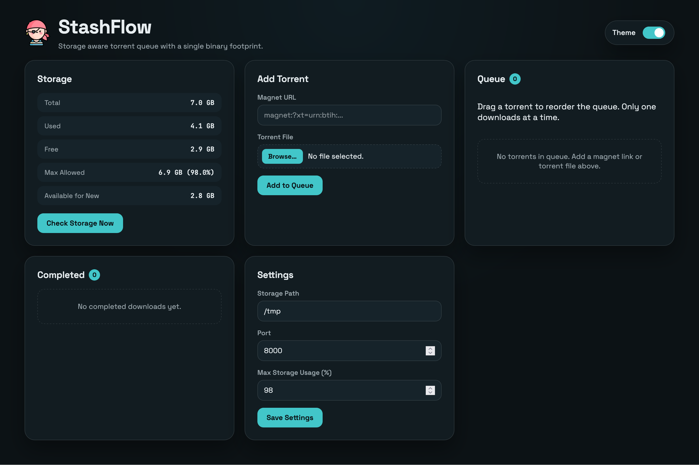

# StashFlow

[](https://github.com/pyprism/StashFlow/actions/workflows/run-tests.yaml)
[](https://codecov.io/gh/pyprism/StashFlow)

<p align="center">
  
</p>

StashFlow is a lightweight torrent client that checks available storage before starting downloads. It runs as a single binary with an embedded web interface, downloads one torrent at a time, and automatically revisits queued downloads as space becomes available.

It was built for a single-board computer with 8 GB of RAM and a `tmpfs` download directory, where storage needs to be freed between downloads. It also works with ordinary disk storage on Linux and macOS.

## Features

- Add magnet links or upload `.torrent` files from the browser.
- Drag to reorder the queue, pause and resume downloads, and remove entries.
- View live download progress and filesystem usage.
- Keep queued torrents passive until they are considered for download.
- Persist queue order and paused state across restarts.
- Configure a filesystem usage threshold, set to 90% by default.
- Run in the background or in the foreground for development and service supervision.

## Screenshot



## Quick start

### Build from source

You need Go 1.26.1 or newer and Git. The web interface is embedded at build time; no separate frontend build is needed.

```bash
git clone https://github.com/pyprism/StashFlow.git
cd StashFlow
go build -o stashflow ./cmd/stashflow
./stashflow start
```

On first start, enter a writable storage path and choose a port:

```text
Storage path: /absolute/path/to/downloads
Port (default 8080):
```

Press Enter to use port `8080`, then open **http://localhost:8080**. If you chose another port, use that port instead. Subsequent starts reuse the saved settings.

### Release binaries

You can also check the [releases page](https://github.com/pyprism/StashFlow/releases) for a binary matching your platform. The release build script targets Linux (`amd64`, `arm`, `arm64`) and macOS (`arm64`). Release archives are gzip-compressed executables, not tar archives.

After downloading an archive, replace the example filename below with the downloaded filename:

```bash
gunzip stashflow-VERSION-linux-arm64.gz
mv stashflow-VERSION-linux-arm64 stashflow
chmod +x stashflow
./stashflow start
```

## Using the web interface

1. Add a magnet link or upload a `.torrent` file.
2. Drag queue entries to choose their order. StashFlow starts an eligible torrent when enough space is available.
3. Pause or resume entries as needed. Paused entries remain paused after a restart.
4. Move or delete finished files from the download directory to free space for more downloads. Use **Check Storage Now** to request an immediate check.

Removing an entry removes its queue record and saved `.torrent` file, but **does not delete downloaded content**.

## How the queue handles storage

StashFlow measures the filesystem containing the configured storage path. By default, it starts a torrent only when the torrent's full size fits below 90% filesystem usage. Other files on that filesystem count toward usage too; the threshold is not a quota on the download directory alone.

For example, on a filesystem with 100 GB total capacity and 80 GB already used, the default threshold leaves about 10 GB available for a new torrent. This is a check before starting a download, not an enforced filesystem quota.

- Only one torrent downloads at a time.
- Uploaded `.torrent` files are parsed offline, so their names and sizes are available before contacting peers.
- Queued magnets stay passive until considered for download. A magnet with an unknown size must fetch metadata before the storage check can finish.
- Queue order determines priority, but a known-size torrent that does not fit can be skipped in favor of a later one that does.
- Downloads waiting for space are checked automatically. A torrent larger than the configured maximum is marked as an error.
- Completed torrents are detached; StashFlow does not keep them running for continued seeding.

The active torrent can discover peers through trackers, DHT, PEX, and webseeds.

Metadata discovery uses the same single slot as downloading, even if the queue is reordered during discovery. Unknown magnets wait when there is no storage headroom. The interface shows which magnet is fetching metadata; other queued magnets remain passive. Fetched metadata is saved in `torrents/` and reused after pauses and restarts. The client may still perform general DHT maintenance while idle; detached queue entries do not announce for their torrents.

## Memory diagnostics

For a diagnostic session, start in the foreground with profiling enabled:

```bash
STASHFLOW_DEBUG=1 ./stashflow start -f
```

This enables the following endpoints on the existing HTTP port, accessible only through direct loopback connections. They are absent by default. If using a reverse proxy, exclude `/debug/` from its public routes: a local proxy's requests also originate on loopback.

```bash
curl -fsS http://127.0.0.1:8080/debug/diagnostics
curl -fsS http://127.0.0.1:8080/debug/pprof/heap -o heap.pb.gz
curl -fsS http://127.0.0.1:8080/debug/pprof/goroutine -o goroutine.pb.gz
go tool pprof -top ./stashflow heap.pb.gz
```

Diagnostics report timestamped Go heap allocation, heap in use, Go runtime system memory, goroutine count, current Linux RSS, peer counts, attached torrent count, queue counts, transition counters, and download-filesystem usage. RSS is `null` on other platforms or when `/proc/self/statm` is unavailable. Attachment/start/detachment events are also written to the service log.

The client budgets are 32 MiB of unverified data, 40 established connections per torrent, 16 half-open connections per torrent, 32 total half-open connections, 256 KiB of allocated peer request data per connection, and one piece hasher. These limit specific resources; they are not a total process-memory cap. DHT, PEX, and webseeds remain enabled for public peer discovery. WebTorrent, uploads, and automatic port forwarding remain disabled.

For a repeatable experiment on an 8 GB Linux machine:

1. Record the OS, architecture, StashFlow version, tmpfs size, storage threshold, and torrent size. Use a torrent you are authorized to download that fits within the configured threshold.
2. Capture a diagnostic baseline with an empty queue. Add several paused/queued entries and confirm only the selected torrent attaches.
3. During a large download, sample diagnostics every five seconds, saving one JSON record per line:

   ```bash
   while true; do
     curl -fsS http://127.0.0.1:8080/debug/diagnostics
     printf '\n'
     sleep 5
   done > memory-samples.jsonl
   ```

4. Capture heap and goroutine profiles during download, after pausing, after resuming, and after completion. Check that attachments fall to zero when paused and never exceed one. Compare transition counters with the service log.
5. Compare peak `resources.rss_bytes`, `resources.heap_alloc_bytes`, peer counts, and `storage.used_bytes`. On tmpfs, downloaded data consumes system RAM separately from the Go heap. Filesystem usage includes other files on the same mount; RSS includes resident mappings and runtime/native memory, so do not simply add RSS and filesystem usage as a precise RAM total.
6. Move completed files out of tmpfs, sample again, and repeat with ordinary disk storage. Go can retain memory for reuse after a download; distinguish retained heap capacity from a continuously growing live heap using the profiles.

No fixed peak-memory figure is assumed for an 8 GB device. Measure with its actual workload before changing the client budgets. A local sampling-overhead benchmark is available with `go test ./internal/torrent -run '^$' -bench BenchmarkResourceSnapshot -benchmem`.

## CLI commands

| Command | Purpose |
| --- | --- |
| `./stashflow start` | Configure on first use, then start in the background. |
| `./stashflow start -f` | Run in the foreground; `--foreground` also works. |
| `./stashflow stop` | Send a termination signal to the running service. |
| `./stashflow status` | Show process status, storage path, port, and queue counts. |
| `./stashflow version` | Print the binary version. |

For local development:

```bash
go run ./cmd/stashflow start -f
```

This uses the same configuration and queue state as the compiled binary. Press Ctrl+C to stop a foreground process.

## Configuration and state

StashFlow stores its configuration separately from downloaded content:

| Platform | Default directory |
| --- | --- |
| Linux | `~/.config/stashflow/` (or `$XDG_CONFIG_HOME/stashflow/` when set) |
| macOS | `~/Library/Application Support/stashflow/` |

| File | Contents |
| --- | --- |
| `config.json` | Storage path, HTTP port, and usage threshold. |
| `state.json` | Queue entries, statuses, and ordering. |
| `torrents/` | Uploaded torrent files used to restore entries. |
| `stashflow.pid` | Running process ID. |
| `stashflow.log` | Background service output. |

Example `config.json`:

```json
{
  "storage_path": "/absolute/path/to/downloads",
  "port": 8080,
  "max_usage_percent": 0.9
}
```

`max_usage_percent` is a fraction: `0.9` means 90%. The web interface accepts usage limits from 1% to 100% and applies changes to the threshold without a restart. Changing the storage path or port requires restarting:

```bash
./stashflow stop
./stashflow start
```

Stop the service before editing configuration or state files manually. A persisted queue does not preserve the contents of a `tmpfs` download directory through a reboot.

The HTTP server listens on all interfaces on the configured port and has no built-in authentication or TLS. For access beyond a trusted local network, place it behind an authenticated HTTPS reverse proxy or a private network.

## Development

```bash
make build          # Build ./stashflow
make test           # Run all tests
make test-cover     # Show test coverage
make coverage-html  # Write coverage.out and coverage.html
make test-bench     # Run benchmarks
make lint           # Run go vet and go fmt (formats source files)
make build-arm64    # Build for Linux ARM64
make help           # List available targets
```

Run the race-enabled test suite used by CI:

```bash
go test -race -coverprofile=coverage.txt ./...
```

To build release archives locally:

```bash
./build-executables.sh v1.0.0
```

Replace the version with the desired release tag. The script recreates `release/` and writes platform-specific `.gz` files there.

## License and credits

StashFlow is available under the [MIT License](LICENSE).

Torrent engine: [anacrolix/torrent](https://github.com/anacrolix/torrent). Pirate icon: [Freepik on Flaticon](https://www.flaticon.com/free-icon/pirate_6208182).
